# cmux-dataview

**Double-click a CSV in cmux. Get a real table next to your terminal.**


<p align="center">
  
</p>

> **Licence.** Source-available, not open source. Free for personal evaluation with credit. Business use, redistribution and derivative works, including AI-made clones, need written permission. See [LICENSE](LICENSE). For a commercial licence or setup help, reach out via [next8n.com](https://next8n.com).

## What is this?

cmux is a terminal app for macOS with a file tree on the side. Double-click a CSV in that tree today and you get raw text, commas and all. cmux-dataview changes that one thing. The same double-click now opens the file as a clean, sortable, searchable table in a split pane, right beside the terminal you are already working in.

It is built for anyone who lives in a terminal and keeps opening data files. Exports from tools, scraped lists, logs, reports. You look at them where you already are, instead of waiting for a spreadsheet app to launch.

## What you get

- **The table you expected, in one double-click.** `.csv`, `.tsv`, `.psv`, `.json` and `.jsonl` open as a real table. No command to remember, no app switch.
- **Files with millions of rows stay fast.** A 58 MB file with 1.5 million rows opens in under a second. Rows arrive as you scroll, so nothing freezes.
- **Answers about the whole file, not only the screen.** Search, column filters, sort and column stats all run over every row. In the 1.5 million row demo file, a search found 500,937 matches.
- **No guessing about your format.** It detects commas, semicolons, tabs and pipes. It reads German decimals like `1.234,56`, UTF-16 Excel exports and Windows encodings, and spots when the first row is data rather than headers. Every guess can be overridden.
- **Nothing else about cmux changes.** Markdown, code and every other file still open in the normal cmux preview.
- **Light on your Mac.** Nothing runs until you double-click a data file. While a table is open it uses about 25 MB, it needs nothing beyond what macOS ships, and it stops itself when you stop using it.

## From install to your first table

1. Clone the repo and run the installer. It backs up your cmux settings first.
   ```bash
   git clone https://github.com/mjmirza/cmux-dataview ~/repositories/cmux-dataview
   ~/repositories/cmux-dataview/install.sh
   ```
2. In cmux, open the **Files** tab in the right sidebar.
3. Double-click any `.csv`. A table opens in a split. That is the whole setup.

The installer ends by running `cmux-dataview --doctor`, which checks every link in the chain and tells you plainly if anything is missing.

## A walk through it

Every screenshot below uses made-up demo data.

### 1. Your files, as cmux shows them

A normal cmux workspace. The terminal on the left, the file tree on the right.

<p align="center">
  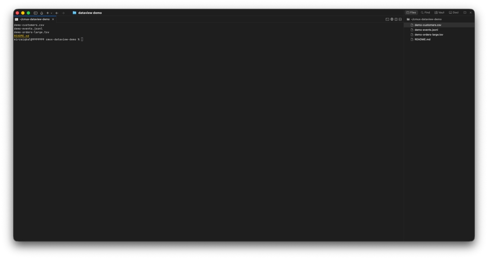
</p>

### 2. Double-click the CSV

The table opens in a split beside the terminal. Double-click another data file and the same pane switches to it, so you never end up with a pile of tabs.

<p align="center">
  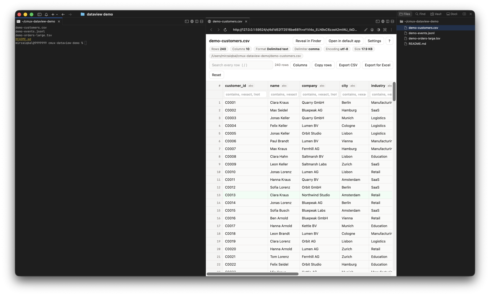
</p>

Drag the divider to give the table more room. The header shows rows, columns, format, delimiter, encoding and size. Each column carries a type badge (`abc` text, `123` whole numbers, `1.5` decimals, `date` dates). Numbers line up on the right.

<p align="center">
  
</p>

### 3. Search every row

Press `/` and type. Matches are highlighted and the count updates as you type, here 19 of 240 rows.

<p align="center">
  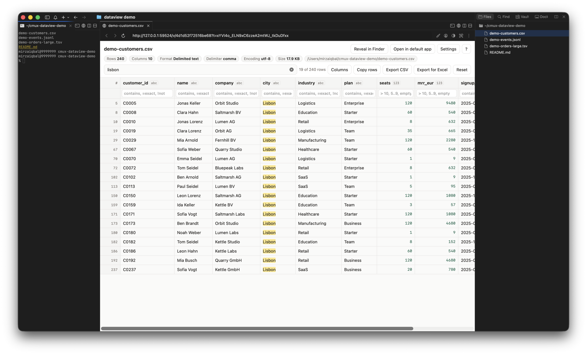
</p>

### 4. Filter columns and sort

Each column has its own filter box under the header.

| Type in a filter | Shows |
|---|---|
| `berlin` | rows containing berlin |
| `=Enterprise` | exactly Enterprise |
| `!trial` | rows without trial |
| `empty` or `!empty` | blank or filled cells |
| `>= 1000`, `< 5`, `!= 0` | number comparisons |
| `10..50` | a number range |

Click a header to sort, click again to reverse, a third time to clear. Here the plan is filtered to Enterprise, revenue to 1000 or more, and the result is sorted by revenue.

<p align="center">
  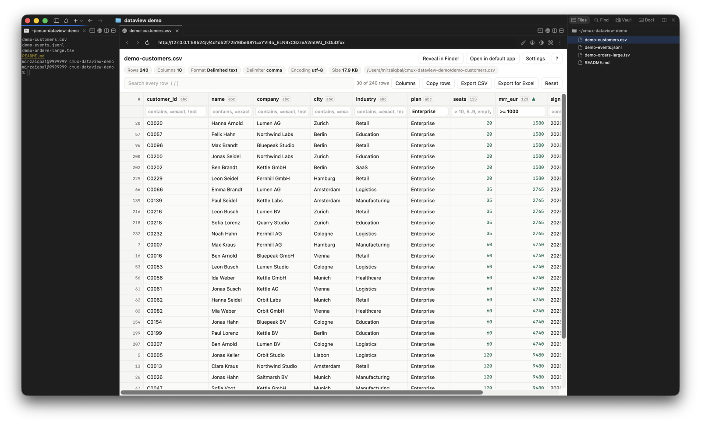
</p>

### 5. Column stats

Right-click any header. You get the type, empty and unique counts, min, max, mean, sum and the most frequent values, computed over the whole file.

<p align="center">
  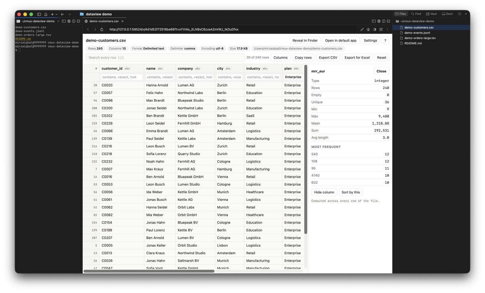
</p>

### 6. JSON and JSON Lines

Nested objects are flattened into columns like `user.country` and `user.plan`, so a log of events reads like a spreadsheet.

<p align="center">
  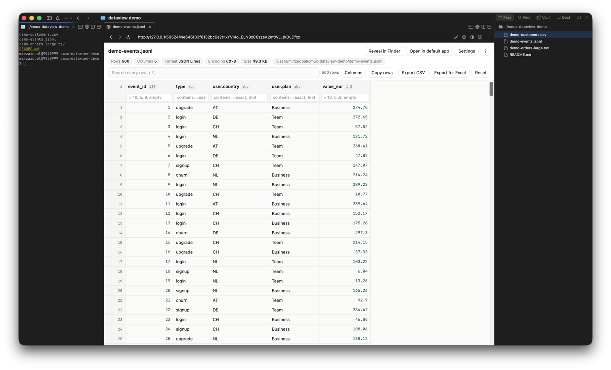
</p>

### 7. Big files

Files over 50 MB open straight away as a preview of the first 50,000 rows. A banner says so, and one click loads the rest.

<p align="center">
  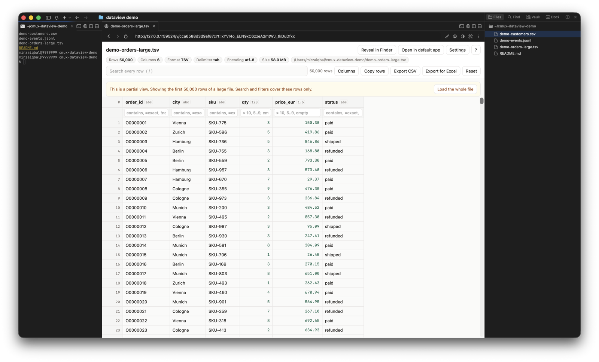
</p>

After loading the whole file, search still covers every row. Here it found 500,937 refunded orders in 1.5 million.

<p align="center">
  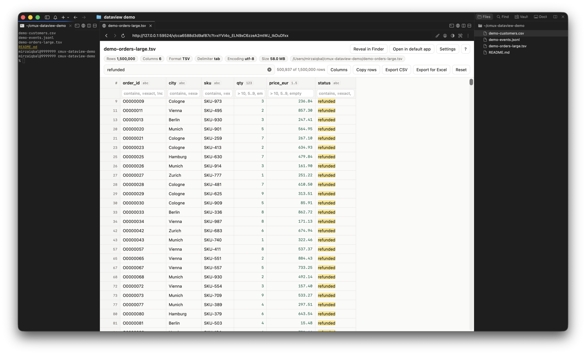
</p>

Prefer to be asked each time? Switch **Large files** to **Ask** in Settings, and a double-click on a big file asks whether you want a preview or the whole thing.

### 8. Settings

Click **Settings** in the viewer. Changes apply right away and are saved to `~/.config/cmux-dataview/config.json`.

<p align="center">
  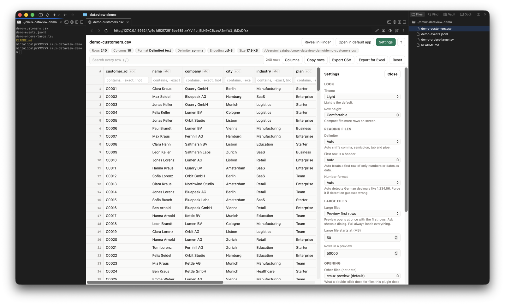
</p>

| Setting | What it does |
|---|---|
| Theme | Light (default) or dark |
| Row height | Comfortable or compact |
| Delimiter, header, number format | Override any automatic guess |
| Large files | Preview first rows (default), ask each time, or always load everything |
| File types shown as tables | Add `log` or `txt` if you keep data in those |
| Other files | Send non-data files to the cmux preview, the macOS default app, or the editor you had before |
| Live reload | Refresh the table when the file changes on disk |
| Export folder | Where Export CSV and Export for Excel save |

Every option is listed in [docs/SETTINGS.md](docs/SETTINGS.md). Keys you add yourself are kept.

### 9. Dark mode

<p align="center">
  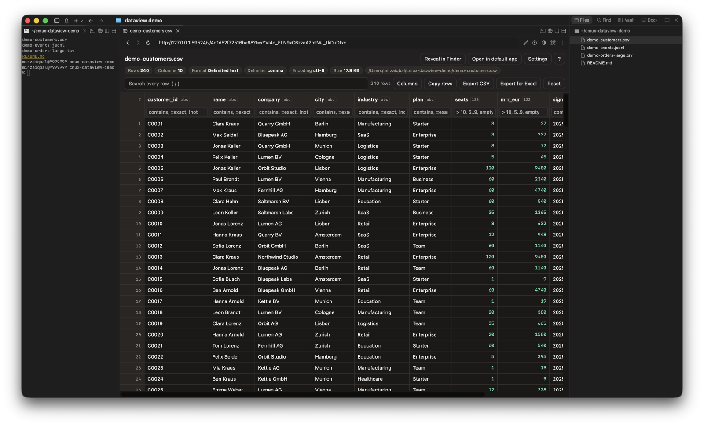
</p>

## Diagrams

The same double-click opens diagram files too.

| File | What you get |
|---|---|
| `.mmd`, `.mermaid` | Mermaid source on the left, the live diagram on the right. Edit and save. |
| `.excalidraw` | The full Excalidraw editor. Draw, edit and save back to the file. |
| `.sketch` | The preview image saved inside the file. Read only, because Sketch is a closed format. |

Mermaid blocks inside Markdown files already render in the normal cmux preview, so those need nothing extra.

<p align="center">
  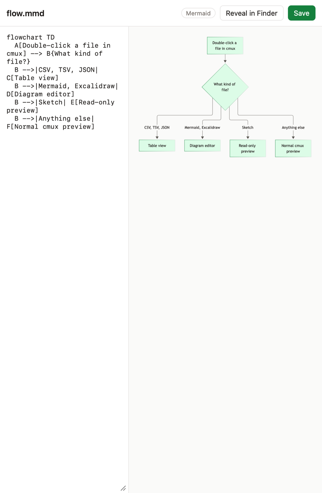
  
</p>

The editors run offline. Install them once.

```bash
cmux-dataview --setup-diagrams
```

That downloads Mermaid and Excalidraw from npm, both MIT licensed, and builds them into `~/Library/Application Support/cmux-dataview/vendor`, about 26 MB. Nothing is fetched from the internet after that. Saving checks whether the file changed on disk after you opened it, and asks before overwriting. Press `Cmd+S` or click **Save**.

Images and PDFs already open in the built-in cmux preview, with zoom and rotate, so cmux-dataview leaves them alone.

## More things it does

- **Live reload.** Save the CSV from another pane and the table refreshes by itself.
- **Hide and show columns** from the Columns panel. Your choice is remembered per file.
- **Copy rows** as tab-separated text, to paste straight into a spreadsheet.
- **Export CSV**, or **Export for Excel**, which neutralises cells a spreadsheet would run as formulas.
- **Reveal in Finder** and **Open in default app**, straight from the viewer.
- **Keyboard first.** `/` to search, arrow keys to move, `?` for every shortcut.
- **Terminal Cmd-click works too.** A path like `report.csv:12` from a stack trace opens the file.
- **Two fast double-clicks give one pane**, not two.

## Light by design

A small helper process does the work behind the table, so it is fair to ask what it costs. These numbers were measured on a MacBook.

| Situation | Memory | CPU |
|---|---|---|
| Not using it | 0, nothing runs | 0% |
| A typical CSV open | about 25 MB | 0% between clicks |
| A 58 MB file open as a preview | about 30 MB | 0% between clicks |
| Searching 2.5 million rows | about 80 MB | busy for about 3.5 seconds |
| Sorting 2.5 million rows | about 160 MB | busy for about 3.5 seconds |

Why a small helper and not a plain web page? A page that opens a file directly has to load every byte of it and build every row before it can show anything. With a file of a few hundred megabytes that freezes the pane. The helper records only where each row starts in the file, then sends the rows that are on screen and nothing more. That is what keeps memory low and scrolling smooth.

The helper only starts when you double-click a data file. It listens on 127.0.0.1 only, behind a random token that changes every start, and stops itself after 10 idle minutes, which hands all of its memory back to macOS. `cmux-dataview --stop` ends it at once.

## How it works

cmux has no plugin API for file viewers yet (upstream issue [#7337](https://github.com/manaflow-ai/cmux/issues/7337)). It does let one command handle file-tree double-clicks, through `fileExplorer.doubleClickAction` set to `preferredEditor`. cmux-dataview installs itself as that command and acts as a dispatcher.

```
double-click ─► cmux-dataview ─┬─ data file ──► local helper ──► table in a cmux browser split
                               └─ other file ─► normal cmux preview (or your previous editor)
```

| Part | Built with | Why |
|---|---|---|
| Dispatcher | Bash plus one Python process | Each extra Python start costs about 0.2 seconds, so routing happens in a single process |
| Helper | Python standard library `http.server` | Nothing to install, ships with the Xcode Command Line Tools |
| Indexing | Byte offsets with quote-aware record detection | Handles quoted newlines and keeps memory flat |
| Viewer | One HTML file with virtual scrolling | Renders only visible rows, works past 8 million pixels of scroll height |
| Pane placement | The cmux CLI | Opens in the focused workspace and reuses an existing viewer pane |

Full design notes are in [docs/DESIGN.md](docs/DESIGN.md).

### Security

- Listens on 127.0.0.1 only, never on your network.
- Every request needs a random token, and the Host header is checked against DNS rebinding.
- The viewer runs under a strict Content Security Policy and loads nothing from the internet.
- Cache and settings files are owner-only.

## Commands

| Command | Does |
|---|---|
| `cmux-dataview <file>` | Open a file as a table, the same as a double-click |
| `cmux-dataview --doctor` | Check the setup |
| `cmux-dataview --config` | Open the settings file |
| `cmux-dataview --stop` | Stop the helper now |
| `cmux-dataview --setup-diagrams` | Install the offline Mermaid and Excalidraw editors |
| `./uninstall.sh` | Remove it and restore your previous cmux settings |

The installer also adds two Command Palette actions, **Data View settings** and **Data View doctor**.

## Requirements

- macOS with [cmux](https://github.com/manaflow-ai/cmux)
- Python 3.9 or newer at `/usr/bin/python3`, from the Xcode Command Line Tools (`xcode-select --install`)

No other dependencies, nothing downloaded at runtime.

## Uninstall

```bash
~/repositories/cmux-dataview/uninstall.sh
```

It restores only the cmux settings it changed, leaves the rest of your `cmux.json` alone, and keeps the timestamped backup made at install.

## Known limits

- Remote file explorers over SSH use the built-in cmux preview, because cmux does not call the dispatcher there.
- `.json` files are loaded whole, up to 200 MB. JSON Lines and delimited files have no size limit.
- After restarting cmux, an old table tab shows "expired". Double-click the file again.

## Project layout

```
bin/cmux-dataview          the dispatcher cmux runs on double-click
lib/dataview_dispatch.py   routing, helper start-up, pane placement
lib/dataview_server.py     the local helper (indexing, paging, search, export)
lib/dataview_render.py     parsing helpers (encodings, delimiters, JSON shapes, types)
lib/dataview_config.py     settings with defaults and validation
lib/dataview_install.py    safe cmux.json install and uninstall
lib/viewer.html            the table UI
lib/diagram.html           the Mermaid, Excalidraw and Sketch view
lib/dataview_diagram.py    diagram reading, saving and the offline editor files
lib/setup-diagrams.sh      one-time build of the offline editors
tests/                     core tests and dispatcher tests
docs/                      design notes, settings reference, screenshots, demo data
```

## Tests

```bash
/usr/bin/python3 -I tests/test_core.py   # parsing, queries, server security, export, settings
bash tests/test_dispatch.sh              # every double-click path, with a fake cmux
```

## Licence

Source-available, not open source. See [LICENSE](LICENSE). Copyright Mirza Iqbal. cmux is built by Manaflow. This tool is independent and not affiliated with it.
